<div align="center">

# 📚 Bazar — Books Mobile App

**A community book marketplace built with Flutter & Firebase**

[](https://flutter.dev)
[](https://dart.dev)
[](https://firebase.google.com)
[](LICENSE)

[Features](#-features) · [Screenshots](#-screenshots) · [Setup](#-setup) · [Architecture](#-architecture) · [Testing](#-testing)

</div>

---

## 📖 About

**Bazar** is a mobile e-commerce app for buying books from independent vendors. It ships with a
complete authentication flow backed by **Firebase Authentication**, a catalogue of books,
vendors and authors, a working favourites system, and a polished custom UI built around a
single deep-purple design language.

The project was built during a training period as a hands-on Flutter & Firebase
application.

---

## ✨ Features

| Area | What it does |
|------|--------------|
| 🚀 **Splash** | Animated entry point with a 2-second branded splash, then smart routing |
| 🧭 **Onboarding** | 3-page intro carousel with a tappable *Skip*, shown **only on first launch** |
| 🔐 **Auth** | Email/password sign-up & sign-in on **Firebase Auth**, with friendly error mapping, loading states and inline password validation |
| 🔢 **Custom keypad** | A purple in-app numeric keypad with a 4-box OTP input — the system keyboard never appears |
| 📧 **Verification** | Email → phone number → phone verification → congratulations journey |
| 🏠 **Home** | Swipeable *Special Offer* carousel with live pagination dots, *Top of Week* books, *Best Vendors* and *Authors* rails |
| 📂 **Category** | Horizontally scrollable category tabs with an item list |
| 🔍 **Search** | Search screen with live result rows |
| 📖 **Book detail** | Bottom sheet with cover, vendor, star rating, quantity stepper and live price total |
| ❤️ **Favourites** | Fully dynamic — favouriting a book adds it to the list, unfavouriting removes it instantly |
| 👤 **Profile** | Live user data (name, email, phone) synced from Firebase, plus My Account, Favourites, Order History and Help Center |
| 🚪 **Logout** | Confirmation sheet that signs out of Firebase, clears local state and returns to onboarding |
| 🎨 **Design system** | One shared palette, one shared `InputDecoration`, one shared button widget, one font (Audiowide) across the entire app |

---

## 📱 Screenshots

### Authentication

| Onboarding | Sign In | Sign Up |
|---|---|---|
| 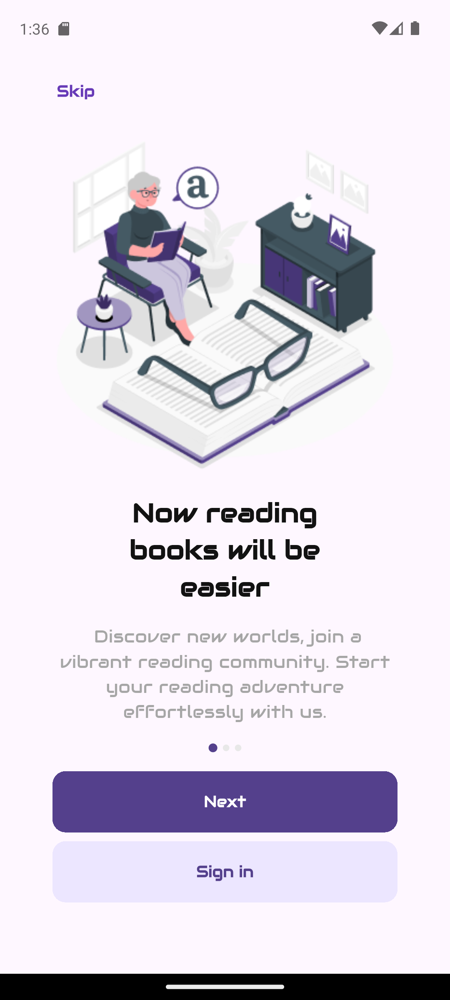 | 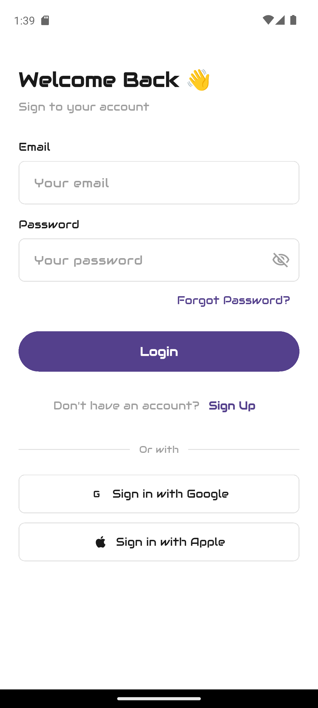 | 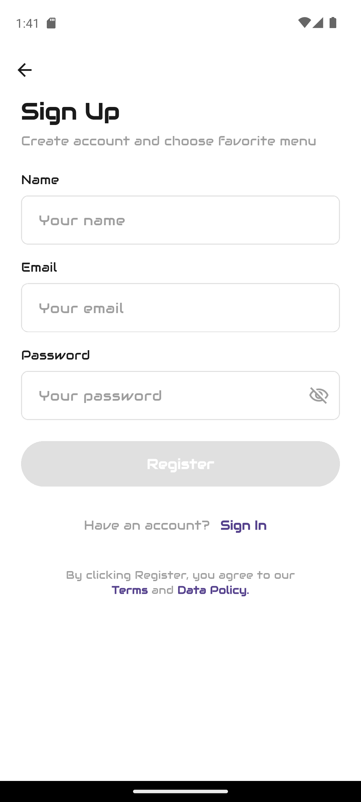 |

| Password validation | Email verification | Phone number |
|---|---|---|
| 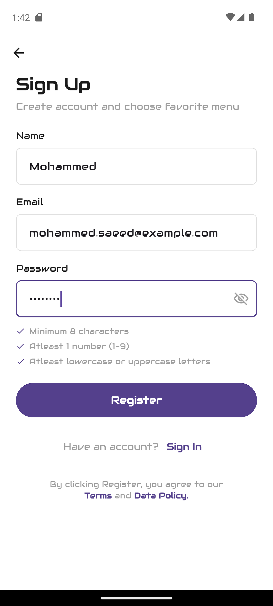 | 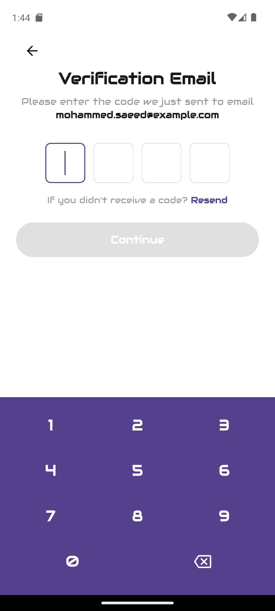 | 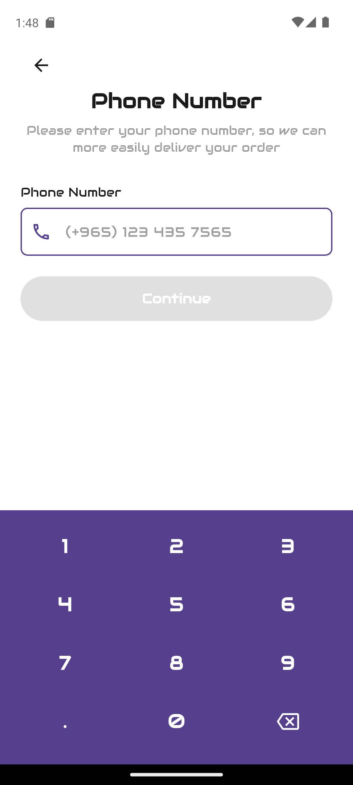 |

| Phone verification | Congratulations |
|---|---|
| 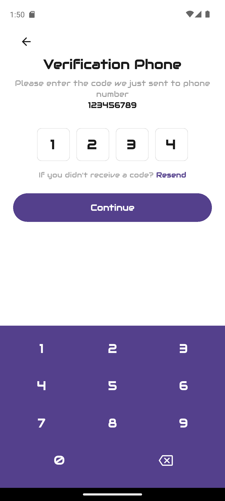 | 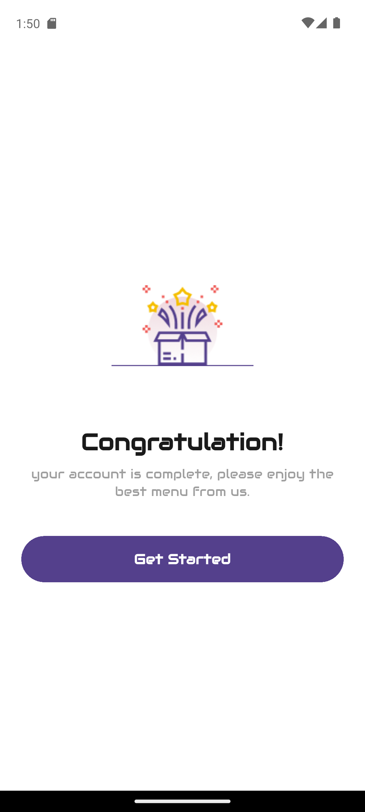 |

### Main app

| Home | Book details | Category |
|---|---|---|
| 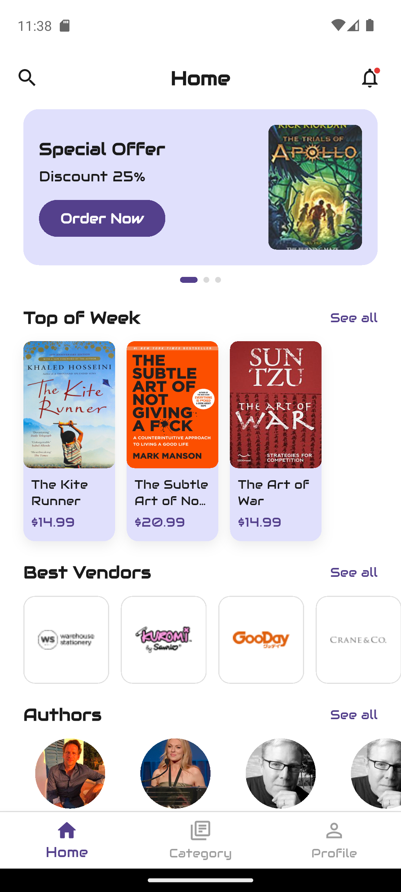 | 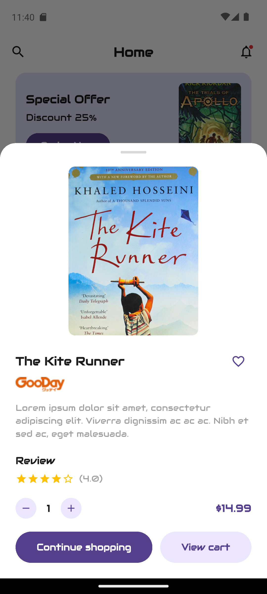 | 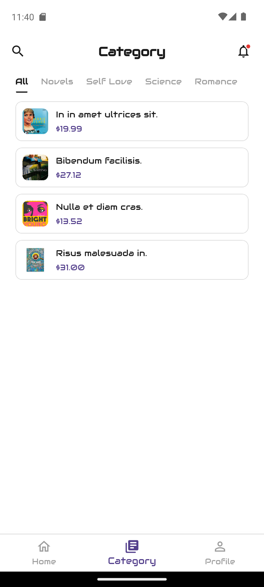 |

| Search | Profile | Logout |
|---|---|---|
|  | 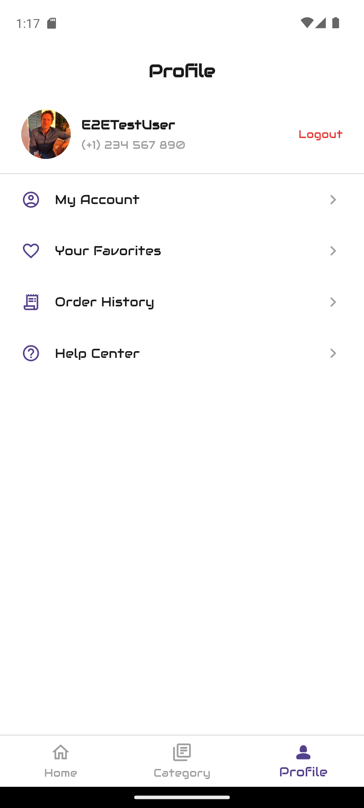 | 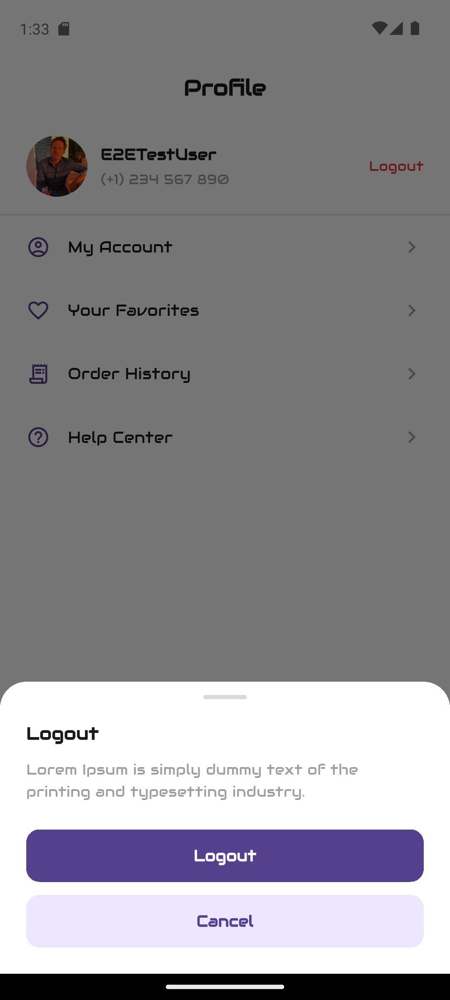 |

| My Account | Favourites | Order History | Help Center |
|---|---|---|---|
| 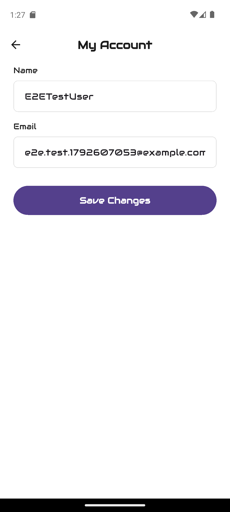 | 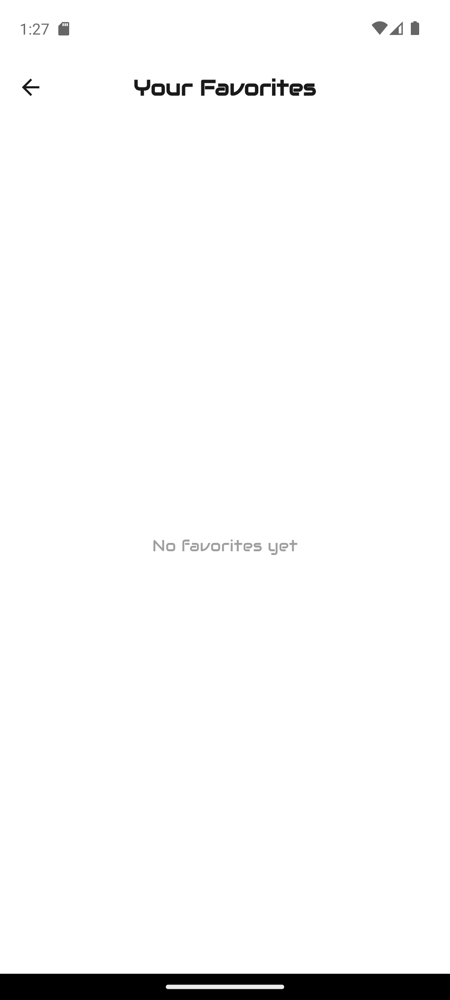 | 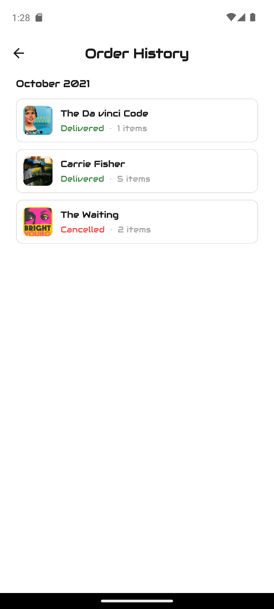 |  |

### Onboarding pages

| Page 1 | Page 2 | Page 3 |
|---|---|---|
|  | 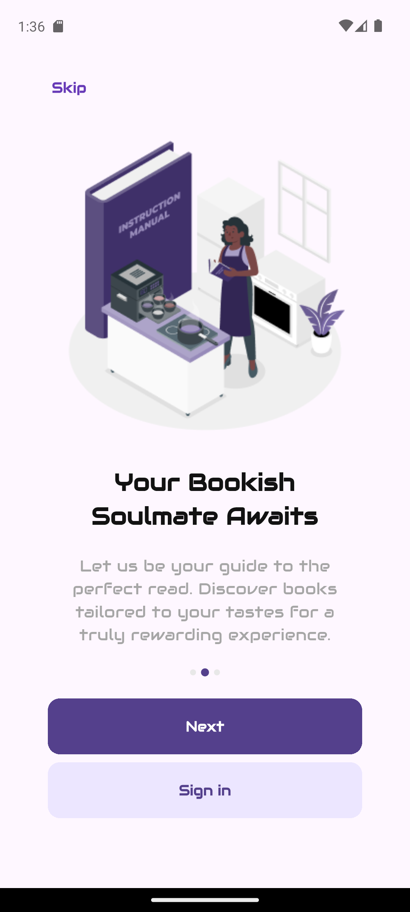 | 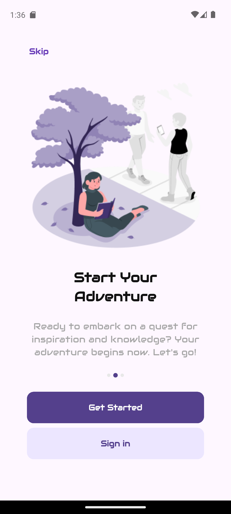 |

---

## 🛠 Setup

### Prerequisites

- Flutter `>= 3.44` (Dart `>= 3.12`)
- Android Studio / Xcode
- A free [Firebase](https://console.firebase.google.com) project

### 1. Clone

```bash
git clone https://github.com/mosaeed11/bazar.git
cd bazar
```

### 2. Install dependencies

```bash
flutter pub get
```

### 3. Configure Firebase

> ⚠️ The Firebase config files are **git-ignored** because they contain project credentials.
> Download your own copies from the Firebase console.

**a. Create the project**

1. Go to the [Firebase console](https://console.firebase.google.com) → **Add project**.
2. Add an **Android** app with package name `com.example.bazar` (or your own).
3. Add an **iOS** app if you plan to build for iOS.
4. Download `google-services.json` and place it at `android/app/google-services.json`.

**b. Enable Email/Password authentication**

`Authentication` → **Get started** → **Sign-in method** → **Email/Password** → **Enable**.

**c. Generate the Flutter options**

```bash
dart pub global activate flutterfire_cli
flutterfire configure
```

This generates `lib/firebase_options.dart`.

> 💡 Template files are included for reference:
> `android/app/google-services.json.example` and `lib/firebase_options.dart.example`.

### 4. Run

```bash
flutter run
```

---

## 🏗 Architecture

```
lib/
├── main.dart                       # Firebase init + named routes + theme
├── splash.dart                     # Splash + first-launch routing
├── onboarding1/2/3.dart           # Onboarding pages
│
├── data/
│   └── dummy_data.dart             # Models + sample catalogue data
│
├── services/
│   ├── auth_service.dart           # Firebase Auth wrapper
│   └── app_prefs.dart              # SharedPreferences (onboarding flag, profile)
│
├── state/
│   └── favorites_store.dart        # ChangeNotifier favourites store
│
├── screens/
│   ├── auth/
│   │   ├── auth_styles.dart        # Shared palette + input decoration + label
│   │   ├── login_screen.dart
│   │   ├── signup_screen.dart
│   │   ├── email_verification_screen.dart
│   │   ├── phone_number_screen.dart
│   │   ├── phone_verification_screen.dart
│   │   └── congratulation_screen.dart
│   ├── home/
│   │   ├── home_screen.dart        # Bottom-nav shell
│   │   ├── book_detail_screen.dart # Modal bottom sheet
│   │   ├── category_screen.dart
│   │   └── search_screen.dart
│   └── profile/
│       ├── profile_screen.dart
│       ├── my_account_screen.dart
│       ├── favorites_screen.dart
│       ├── order_history_screen.dart
│       └── help_center_screen.dart
│
└── widgets/
    ├── auth_button.dart             # Shared primary button
    ├── otp_input_row.dart           # 4-box OTP input + key-handling mixin
    └── custom_numpad.dart           # Purple in-app numeric keypad
```

### Design decisions

- **One palette, one source of truth.** `AppColors` in `auth_styles.dart` holds every colour.
  The same file provides `buildAuthInputDecoration()` so no field in the app is styled twice.
- **Local theme per feature.** `buildAuthTheme()` wraps each feature area with a scoped
  `ThemeData`, keeping the global Audiowide brand font for the marketing/onboarding screens
  while giving the app screens a clean, dense reading style.
- **No third-party state management.** The favourites list is a plain `ChangeNotifier`
  (`FavoritesStore`) consumed through `ListenableBuilder` — no provider, no riverpod.
- **No network images.** Every image is a local asset rendered with `Image.asset` and a
  graceful `errorBuilder` fallback, so the UI never breaks when a file is missing.
- **The system keyboard is suppressed on numeric screens** with `readOnly: true` +
  `TextInputType.none`, and a custom purple keypad takes over — a deliberate product
  decision matching the Figma design.

### Routes

| Route | Screen |
|---|---|
| `/` | Splash → routes to onboarding or home |
| `/onboarding` | Onboarding page 1 |
| `/login` | Sign in |
| `/signup` | Sign up |
| `/email-verification` | Email OTP |
| `/phone-number` | Phone number |
| `/phone-verification` | Phone OTP |
| `/congratulation` | Congratulations |
| `/home` | Home (bottom-nav shell) |

---

## 🔐 First-launch & session behaviour

The app remembers whether the user has completed onboarding:

- **First ever launch** → splash → **onboarding** → sign-up/sign-in flow.
- **Any later launch** → splash → **straight to Home** (no onboarding).
- **After logging out** → the flag is cleared, local profile data and favourites are wiped,
  and the user is returned to **onboarding**.

---

## 🧪 Testing

```bash
flutter test          # unit tests
flutter analyze       # static analysis
```

The test suite covers the favourites store behaviour, catalogue data integrity (unique book
IDs, valid image paths) and the design-system colour constant.

---

## 🎨 Design system

| Token | Value | Usage |
|---|---|---|
| Primary | `#54408C` | Buttons, active states, focus rings, headers |
| Primary light | `#ECE6FF` | Secondary buttons, icon chips |
| Card surface | `#E0E0FC` | Book cards, banners |
| Rating | `#FFC107` | Stars |
| Vendor name | `#F4A000` | Vendor labels |
| Text primary | `#1A1A1A` | Headings, body |
| Text secondary | `#9E9E9E` | Subtitles, hints |
| Error | `#E53935` | Logout, validation failures |
| Font | Audiowide | Display headings |
| Input radius | `8px` | Fields, cards |
| Button radius | `30px` | Primary buttons |

---

## 📦 Dependencies

| Package | Purpose |
|---|---|
| `firebase_core` | Firebase initialisation |
| `firebase_auth` | Email/password authentication |
| `shared_preferences` | First-launch flag & local profile cache |
| `cupertino_icons` | iOS-style icons |

---

## 🚧 Roadmap

- [ ] Google & Apple sign-in
- [ ] Real email verification and phone OTP via Firebase
- [ ] Cart and checkout flow
- [ ] Cloud Firestore catalogue
- [ ] Order history backed by Firestore
- [ ] Address management

---

## 👤 Author

**Mohammed Saeed** — developed the project solo during a training period.

---

## 📄 License

Released under the [MIT License](LICENSE).

<div align="center">
Made with ❤️ using Flutter & Firebase
</div>
